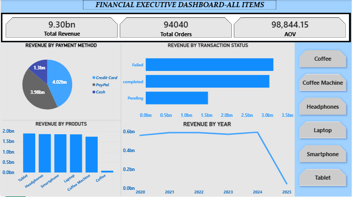
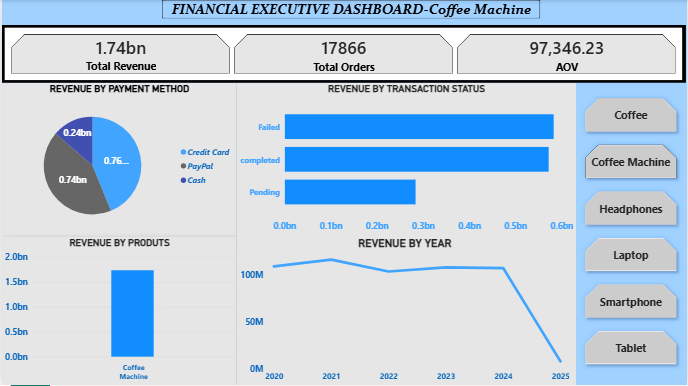
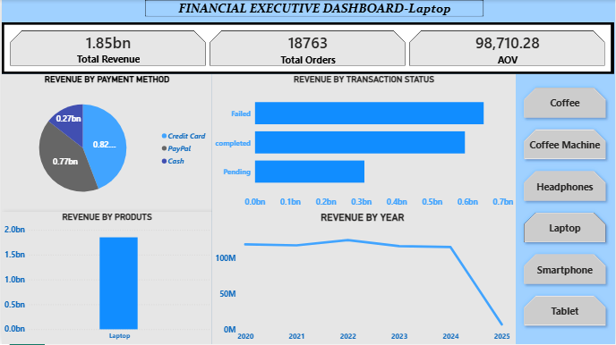
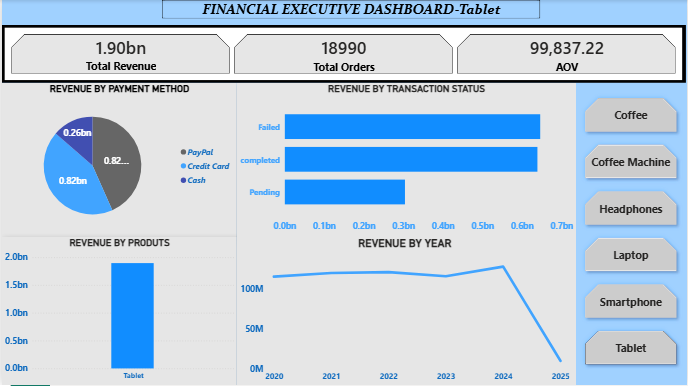
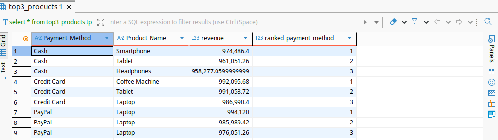
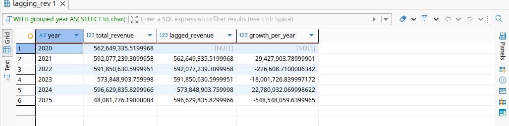
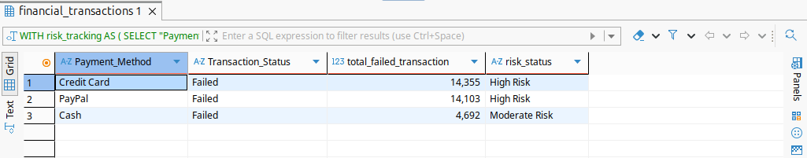
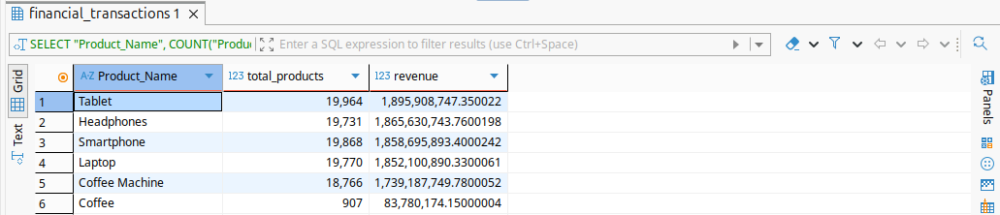

# Financial Transaction Analytics

## Project Overview

An end-to-end data analytics built using financial transaction dataset.

---

## Tech Stack

- Python
- Pandas
- NumPy
- PostgreSQL
- SQL
- Power BI
- Excel
---

## Pipeline

Kaggle Download

↓

Data Cleaning

↓

Feature Engineering

↓

PostgreSQL

↓

SQL Analytics

↓

Power BI Dashboarding

---

## Author

Owen Darry

## 📸 Dashboard Preview

### Financial Transaction Analytics Dashboards

### Financial Transactions SQL Tables

